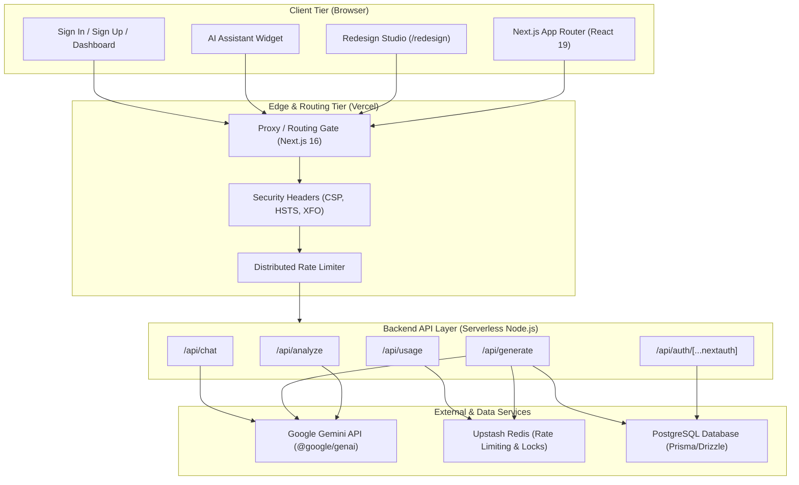
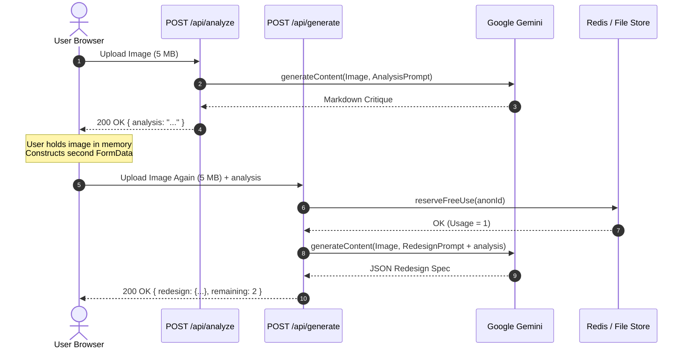
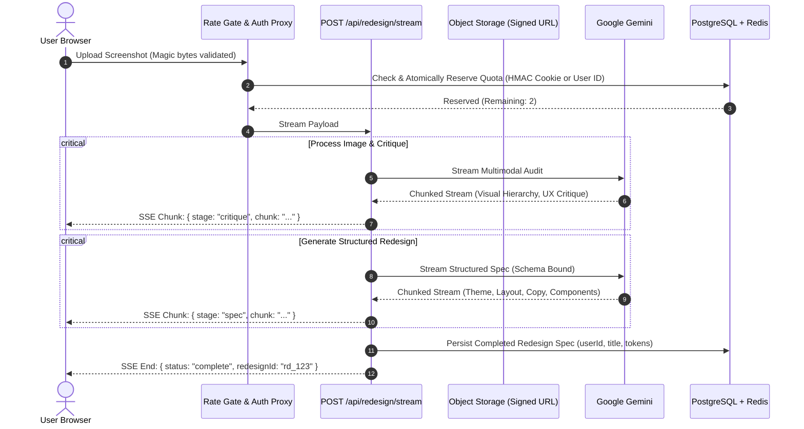

# ReDesignAI System Architecture & Target Design Blueprint

**Document:** Architecture Specification & System Blueprint  
**Auditor:** Principal Software Engineer, Application Security Reviewer, and System Architect  
**Status:** Architecture Blueprint (Read-Only Baseline & Target Specification)  
**Date:** October 2026  

---

## 1. System Overview & Architecture Context

ReDesignAI is an AI-powered design acceleration platform. It enables frontend engineers, UI/UX designers, and product teams to upload screenshots of existing web interfaces, receive automated structural design critiques, and generate responsive, themed redesign prototypes that can be inspected and exported.



---

## 2. Current Architecture vs. Target Production Architecture

### 2.1 Current State Architecture (Defects & Anti-Patterns)
1. **Ad-Hoc Storage Split:** Relies on an unconfigured or partially configured Upstash Redis REST interface with a local JSON file fallback (`data/users.json`, `data/anon-usage.json`).
   - On Vercel, `process.cwd()` is read-only, throwing `EROFS`.
   - `/tmp` is ephemeral and isolated per container instance, causing loss of accounts and counters on cold starts.
2. **REST URL Path Encoding:** Redis `SET` commands are formatted into URL paths (`/set/<key>/<value>`), violating HTTP URL specifications for large JSON payloads.
3. **Double Ingress Overhead:** The client uploads the same screenshot twice in sequential API calls (`/api/analyze` followed by `/api/generate`).
4. **Blocking AI Execution:** All AI routes wait for full generation completion before returning JSON, resulting in 10–25 second blank spinners without streaming feedback.
5. **Deprecated Middleware:** Uses Next.js `middleware.ts` which is deprecated in Next.js 16 in favor of `proxy`.
6. **Ghost History:** Dashboard queries `getRecentRedesignsForUser` which returns a hardcoded empty array `[]`.

### 2.2 Target Production Architecture (Modern Serverless Best Practice)
1. **Stateless Compute:** All serverless functions are 100% stateless. No local file operations.
2. **Managed Relational Storage:** PostgreSQL (via Neon, Supabase, or AWS Aurora Serverless) managed by an ORM (Prisma or Drizzle) for users, accounts, projects, redesign specifications, and audit logs.
3. **Distributed Redis Layer:** Upstash Redis used strictly for its strengths: atomic increments, sliding-window rate limiting, distributed locking (`withRedisLock`), and ephemeral cache.
4. **Single-Upload Pipeline:** Image uploaded once to an ephemeral object store (e.g. Vercel Blob / S3 / Cloudinary) with signed URLs, or processed in a unified streaming pipeline.
5. **Streaming AI Responses:** Gemini responses streamed to client via Server-Sent Events (SSE) or Web Streams for instant perceived performance.
6. **Next.js 16 Proxy Migration:** Compliance with modern Next.js 16 routing conventions.

---

## 3. Data Flow Diagrams

### 3.1 Current Redesign Flow (Inefficient, Redundant Uploads)


### 3.2 Target Redesign Flow (Optimized, Single Ingress, Streaming)


---

## 4. Proposed Database Schema (Relational PostgreSQL)

To resolve the persistence, concurrency, and redesign history defects, the following schema is specified for PostgreSQL (via Prisma or Drizzle):

```prisma
datasource db {
  provider = "postgresql"
  url      = env("DATABASE_URL")
}

generator client {
  provider = "prisma-client-js"
}

model User {
  id            String    @id @default(cuid())
  name          String?
  email         String    @unique
  emailVerified DateTime?
  passwordHash  String
  image         String?
  createdAt     DateTime  @default(now())
  updatedAt     DateTime  @updatedAt

  accounts      Account[]
  sessions      Session[]
  redesigns     Redesign[]
  quotas        UserQuota?
}

model Account {
  id                String  @id @default(cuid())
  userId            String
  type              String
  provider          String
  providerAccountId String
  refresh_token     String? @db.Text
  access_token      String? @db.Text
  expires_at        Int?
  token_type        String?
  scope             String?
  id_token          String? @db.Text
  session_state     String?

  user User @relation(fields: [userId], references: [id], onDelete: Cascade)

  @unique([provider, providerAccountId])
}

model Session {
  id           String   @id @default(cuid())
  sessionToken String   @unique
  userId       String
  expires      DateTime
  user         User     @relation(fields: [userId], references: [id], onDelete: Cascade)
}

model Redesign {
  id              String   @id @default(cuid())
  userId          String
  title           String
  subtitle        String?
  description     String?  @db.Text
  primaryButton   String?
  secondaryButton String?
  theme           Json     // { background, surface, accent, text }
  layout          String?  @db.Text
  designStyle     String?  @db.Text
  improvements    String[]
  analysisExcerpt String?  @db.Text
  createdAt       DateTime @default(now())

  user User @relation(fields: [userId], references: [id], onDelete: Cascade)

  @@index([userId, createdAt(sort: Desc)])
}

model UserQuota {
  id           String   @id @default(cuid())
  userId       String   @unique
  generations  Int      @default(0)
  tier         String   @default("free") // "free" | "pro" | "team"
  resetAt      DateTime?

  user User @relation(fields: [userId], references: [id], onDelete: Cascade)
}

model AnonymousUsage {
  id          String   @id @default(cuid())
  anonHash    String   @unique // HMAC-SHA256(anonId)
  ipHash      String?  // Truncated / salted IP hash
  count       Int      @default(0)
  createdAt   DateTime @default(now())
  updatedAt   DateTime @updatedAt

  @@index([anonHash])
  @@index([ipHash])
}
```

---

## 5. Security & Isolation Architecture

### 5.1 Cookie Hardening Specification
- **NextAuth Session Cookie:**
  - `name`: `__Host-rdai.session-token` (in production) / `rdai.session-token` (dev)
  - `httpOnly`: `true`
  - `secure`: `true` (in production)
  - `sameSite`: `"lax"`
  - `path`: `"/"`
- **Anonymous Tracking Cookie (`rdai_anon`):**
  - Stored format: `<uuid>.<hmacSignature>`
  - Generated using `crypto.createHmac("sha256", secret).update(uuid).digest("hex")`
  - Verification: Recomputes HMAC on request. If signature fails, cookie is rejected and rewritten.

### 5.2 Serverless Configuration Specifications
To ensure smooth execution within Vercel's execution limits:
1. **Max Duration Declaration:** Every route utilizing Gemini models must specify:
   ```typescript
   export const maxDuration = 60; // Configured for Vercel Serverless
   export const dynamic = "force-dynamic";
   ```
2. **Payload Size Guard:** Enforce maximum client body size of 4 MB at the route level to remain well within Vercel's 4.5 MB serverless limit:
   ```typescript
   const MAX_FILE_SIZE = 4 * 1024 * 1024; // 4 MB
   ```

### 5.3 Next.js 16 Proxy Migration Specification
Next.js 16 deprecates `middleware.ts`. The target architecture migrates edge routing logic to the Next.js `proxy` convention or route handlers:
- Moving auth redirection checks to App Router server component layouts or proxy config.
- Applying security headers in `next.config.ts`.
- Handling rate limits in an edge middleware/proxy layer backed by `@upstash/ratelimit`.

---

## 6. AI Integration & Prompt Architecture

### 6.1 System Prompt Separation
The current architecture concatenates user inputs directly into prompt bodies. The target architecture strictly enforces SDK `systemInstruction`:
```typescript
const ai = getGeminiClient();

const response = await ai.models.generateContent({
  model: GEMINI_STRUCTURED_MODEL,
  config: {
    systemInstruction: SYSTEM_INSTRUCTION_REDESIGN,
    responseMimeType: "application/json",
    responseSchema: redesignResponseSchema,
  },
  contents: [
    imagePart,
    {
      role: "user",
      parts: [
        {
          text: `Please redesign the attached website. Reference analysis:\n<user_analysis>\n${sanitizedAnalysis}\n</user_analysis>`,
        },
      ],
    },
  ],
});
```

### 6.2 Model Resilience & Fallbacks
- Primary Model: `gemini-2.5-flash` or `gemini-1.5-flash` (or environment-configured override).
- Fallback Strategy: If primary returns 503 / 429 after 3 retries, fail over gracefully to secondary model or cached template response.
